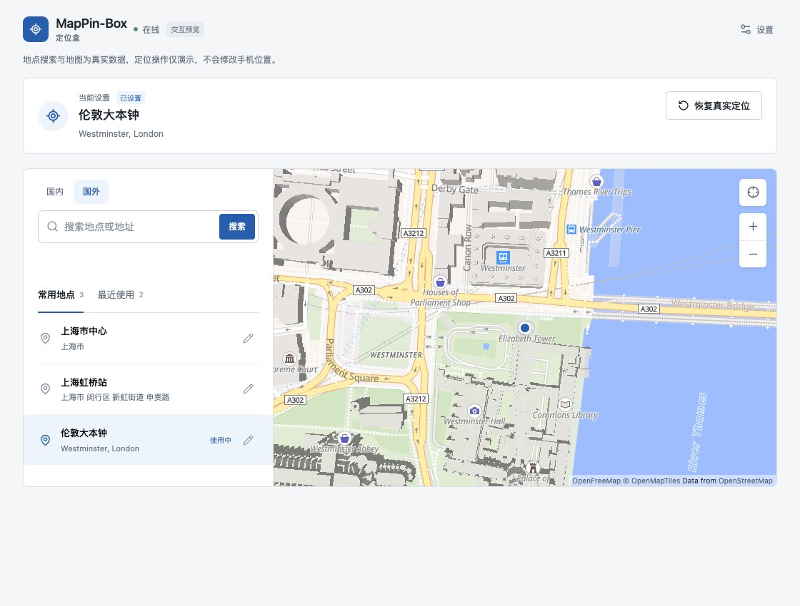

# MapPin-Box

用一块 **ESP32-S3 N16R8** 或 **微雪 ESP32-WROVER‑E** 和 iPhone 上的 Safari，搜索地点、确认地图，再把模拟位置发送给 iPhone。WROVER‑E 优先使用经典蓝牙，Wi-Fi 热点保留为备用；ESP32-S3 使用 Wi-Fi。

*An ESP32 box for simulating iPhone location over Bluetooth or Wi-Fi from a local web interface.*



## 使用方式

1. 给盒子供电。WROVER‑E 会尝试通过蓝牙连接已绑定的 iPhone；在手机打开蜂窝数据、蓝牙和 **个人热点 → 允许其他人加入**，然后打开蓝牙地址（通常为 [172.20.10.2](http://172.20.10.2/)）。首次绑定或改用 Wi-Fi 时，加入 **`MapPin-XXXX`**（初始密码 **`mappin-setup`**），打开 [192.168.71.1](http://192.168.71.1/)。
2. 在同一个网页搜索地点或地址，在地图上选中地点，点击 **定位到这里**。常用地点可以收藏，下次直接选用。
3. 在网页点 **恢复真实定位**，或短按板上的 **BOOT**。长按 BOOT 约 3 秒可重新使用最近一次成功的地点。断开设备前，可以在苹果地图确认定位已恢复。

国内可配置高德或天地图，国外可使用 OpenStreetMap 数据或配置 Google 地图。在线地图和搜索需要互联网。地图凭证可在 **设置 → 地图服务** 修改；高德也支持在 Mac 上配置一次，烧录时自动写入。

WROVER‑E 首次接入 iOS 27 或更新版本时，先打开 iPhone 开发者模式。连上备用 Wi-Fi 后，在 **设置 → 使用帮助 → 接入新 iPhone** 扫描蓝牙设备、选择 iPhone，核对两边的数字并确认。蓝牙连上后，点 **打开蓝牙页面 → 开始开发者配对**。在 iPhone 的 **设置 → 隐私与安全性 → 开发者模式** 页面下方选网页显示的盒子。盒子收到请求才显示六位码。输入后即可保存开发者配对，之后可用同一份配对在蓝牙或 Wi-Fi 下改位。扫描时让 iPhone 停在蓝牙设置，必要时用另一台设备打开备用 Wi-Fi 页面。

如果开发者模式或定位服务未就绪，可以走 Mac 接入流程；手机重启或升级后也可能需要重新准备定位服务。

## 从源码开始

需要受支持的 16 MB Flash / 8 MB PSRAM 开发板、数据线、一台用于烧录的 Mac 和可开启开发者模式的 iPhone。烧录用板载 USB 转串口，微雪 WROVER‑E 使用唯一的 Type‑C 口。

在 Mac 上安装 Xcode Command Line Tools、[Rustup](https://rustup.rs/) 和 Python。ESP32-S3 使用 ESP-IDF v5.5.3；WROVER‑E 的构建脚本固定到含经典蓝牙 PAN 的 ESP-IDF 提交。

```sh
git clone https://github.com/LouDylan/MapPin-Box.git
cd MapPin-Box

python3.14 -m venv .venv
.venv/bin/python -m pip install -r requirements.txt

cargo install --locked espup
espup install
cargo install --locked ldproxy
cargo install --locked espflash --version 4.7.0
```

使用默认的 `~/export-esp.sh`，或通过 `MAPPIN_ESP_ENV` 指定 espup 生成的环境脚本。[Espressif 工具链说明](https://docs.espressif.com/projects/rust/book/getting-started/toolchain.html)

```sh
./编译开发板固件.command
./烧录开发板固件.command
```

以上默认构建和烧录 ESP32-S3。微雪 ESP32-WROVER‑E 使用对应目标，产物位于 `firmware/build-output/wrover-e/`。

```sh
MAPPIN_BOARD=wrover-e ./编译开发板固件.command
MAPPIN_BOARD=wrover-e ./烧录开发板固件.command
```

需要给多块板预配置高德时，先运行 **`./保存高德烧录配置.command`**，输入自己的[高德 Web 端（JS API）Key 和安全密钥](https://lbs.amap.com/api/javascript-api-v2/guide/abc/jscode)。Mac 会将它们保存在 `~/.config/mappin-box/amap.json`。之后用本项目的烧录脚本，板上缺少高德配置时会通过 USB 自动写入；已有高德配置和地图源选择会保留。公开固件不包含高德凭证。

若使用 ESP32-S3，或 WROVER‑E 需要通过 Mac 接入，把解锁的 iPhone 也接到 Mac，运行 **`./接入新iPhone.command`**。按手机提示信任电脑、开启开发者模式。接入助手会准备定位服务，并经本地串口导入此手机的配对资料。手机重启或系统更新后若无法连接，可运行 **`./准备iPhone定位服务.command`**。

## 本地预览和测试

预览只在本机运行，使用示例设备状态和地点。

```sh
.venv/bin/python tools/ux_preview.py
```

在浏览器打开 [127.0.0.1:8765](http://127.0.0.1:8765/)。也可以从仓库根目录运行以下检查。

```sh
node --test tests/*.test.mjs
.venv/bin/python -m unittest discover -s tests
cargo +stable test --locked --manifest-path firmware/model/Cargo.toml
```

## 项目结构

| 目录或文件 | 内容 |
| --- | --- |
| `firmware/` | ESP32-S3 和 ESP32-WROVER‑E 固件、控制网页和数据模型 |
| `*.command` | macOS 上的构建、烧录、接入和恢复入口 |
| `tools/ux_preview.py` | 可在浏览器体验的本地预览 |
| [`tools/usb-ncm-probe/`](tools/usb-ncm-probe/) | USB-C 有线网络与定位实验。已验证能打开网页，USB 定位和恢复仍待实测 |
| [`tools/bluetooth-pan-probe/`](tools/bluetooth-pan-probe/) | 微雪 WROVER‑E 的经典蓝牙 PAN、开发者配对与定位实验 |
| [`vendor/enigma/`](vendor/enigma/UPSTREAM.md) | 按固定提交保留的 Enigma 依赖及其许可证 |

完整备份包含 iPhone 开发者配对资料、Wi-Fi 配置和地图凭证，应保存在本机。可在 **设置 → 使用帮助** 导出 `.mappinbackup`，再用 **`./恢复盒子备份.command`** 恢复到分区布局匹配的开发板。换板后需要重新绑定系统蓝牙。恢复工具也接受旧版完整备份。

项目采用 [GPL-3.0-only](LICENSE)。上游 Enigma 的来源见 [依赖说明](vendor/enigma/UPSTREAM.md)，网页组件的许可证见 [第三方许可](firmware/licenses/)。
