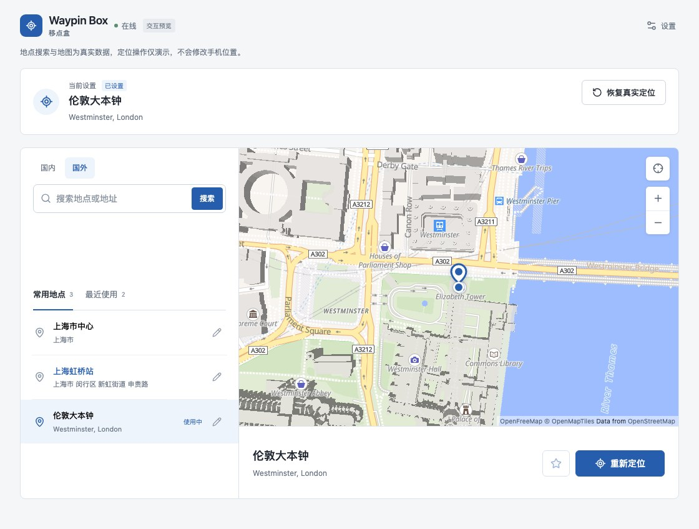

# Waypin Box · 移点盒

用一块 **ESP32-S3 N16R8** 和 iPhone 上的 Safari，搜索地点、确认地图，再把模拟位置发送给 iPhone。首次接入用 Mac，之后移点盒可以独立供电使用。

*An ESP32-S3 box for simulating iPhone location over Wi-Fi from a local web interface.*



## 使用方式

1. 给移点盒供电。首次使用或尚未自定义热点时，iPhone 加入 **`Waypin-XXXX`**，初始密码为 **`waypin-setup`**。热点名称和密码可在 **设置 → Wi-Fi 连接** 修改。
2. 在 Safari 打开 [192.168.71.1](http://192.168.71.1/)，搜索地点或地址，在地图上选中地点，点击 **定位到这里**。常用地点可以收藏，下次直接选用。
3. 在网页点 **恢复真实定位**，或短按板上的 **BOOT**。长按 BOOT 约 3 秒可重新使用最近一次成功的地点。断开设备前，可以在苹果地图确认定位已恢复。

国内可配置高德或天地图，国外可使用 OpenStreetMap 数据或配置 Google 地图。在线地图和搜索需要互联网；使用高德、天地图或 Google 时，在 **设置 → 地图服务** 填写自己的凭证。

## 从源码开始

需要一块 **16 MB Flash / 8 MB PSRAM** 的 ESP32-S3 N16R8 开发板、数据线、一台 Mac 和可开启开发者模式的 iPhone。烧录与首次接入使用开发板的 **COM** 串口。首次准备 iPhone 时，Mac 可能需要联网下载对应的开发者镜像。

在 Mac 上安装 Xcode Command Line Tools、[Rustup](https://rustup.rs/) 和 Python。此版本使用 ESP-IDF v5.5.3，并用 Python 3.14 验证。

```sh
git clone https://github.com/LouDylan/waypin-box.git
cd waypin-box

python3.14 -m venv .venv
.venv/bin/python -m pip install -r requirements.txt

cargo install --locked espup
espup install
cargo install --locked ldproxy
cargo install --locked espflash --version 4.7.0
```

使用默认的 `~/export-esp.sh`，或通过 `WAYPIN_ESP_ENV` 指定 espup 生成的环境脚本。[Espressif 工具链说明](https://docs.espressif.com/projects/rust/book/getting-started/toolchain.html)

```sh
./编译开发板固件.command
./烧录开发板固件.command
```

烧录后，把解锁的 iPhone 也接到 Mac，运行 **`./接入新iPhone.command`**。按手机提示信任电脑、开启开发者模式。接入助手会准备定位服务，并经本地串口导入此手机的配对资料。手机重启或系统更新后若无法连接，可运行 **`./准备iPhone定位服务.command`**。

## 本地预览和测试

预览只在本机运行，使用示例设备状态和地点。

```sh
.venv/bin/python tools/ux_preview.py
```

在浏览器打开 [127.0.0.1:8765](http://127.0.0.1:8765/)。也可以从仓库根目录运行以下检查。

```sh
node --test tests/*.test.mjs
.venv/bin/python -m unittest discover -s tests
cargo +stable test --locked --manifest-path firmware/model/Cargo.toml
```

## 项目结构

| 目录或文件 | 内容 |
| --- | --- |
| `firmware/` | ESP32-S3 固件、控制网页和数据模型 |
| `*.command` | macOS 上的构建、烧录、接入和恢复入口 |
| `tools/ux_preview.py` | 可在浏览器体验的本地预览 |
| [`tools/usb-ncm-probe/`](tools/usb-ncm-probe/) | USB-C 有线网络与定位实验。已验证能打开网页，USB 定位和恢复仍待实测 |
| [`vendor/enigma/`](vendor/enigma/UPSTREAM.md) | 按固定提交保留的 Enigma 依赖及其许可证 |

完整备份包含 iPhone 配对资料、Wi-Fi 配置和地图凭证，应保存在本机。可在 **设置 → 使用帮助** 导出 `.waypinbackup`，再用 **`./恢复盒子备份.command`** 恢复到分区布局匹配的开发板。恢复工具也接受旧版 `.i4backup` 文件。

项目采用 [GPL-3.0-only](LICENSE)。上游 Enigma 的来源见 [依赖说明](vendor/enigma/UPSTREAM.md)，网页组件的许可证见 [第三方许可](firmware/licenses/)。
